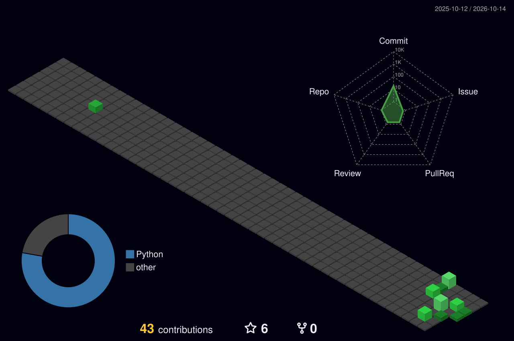

<!-- Animated header banner -->
<p align="center">
  
</p>

<!-- Typing animation -->
<p align="center">
  <a href="https://github.com/pauloDiego-sudo">
    
  </a>
</p>

<p align="center">
  
  
  
</p>

---

## 🚀 About Me

```python
class Paulo:
    def __init__(self):
        self.role       = "Computer Engineering Student @ IFCE 🇧🇷"
        self.exchange   = "ENSICAEN 🇫🇷 — Cybersecurity & AI (2025–2026)"
        self.experience = "~3 years building software"
        self.stack      = ["Embedded (C/FreeRTOS, C++/Qt)", "Full-Stack", "AI & LLMs"]
        self.languages  = ["Português 🇧🇷", "English 🇬🇧", "Français 🇫🇷", "中文 (basic) 🇨🇳"]
        self.looking_for = "Remote software engineering opportunities 🌍"

    def motto(self):
        return "It works, and it's robust. ✅"
```

- 🔭 Recently finished a **software development internship at Orange Innovation** (France)
- 🌱 Diving deeper into **AI security, LLMs and RAG**
- 🏆 Competed twice in the **ICPC** South America/Brazil regional
- 💬 Ask me about **competitive programming, algorithms, or Brazil!**
- ⚡ Fun fact: I'm learning to play songs on electric guitar 🎸

---

## 🎓 Education

| | Institution | Program | Period |
| :---: | :--- | :--- | :---: |
| 🇧🇷 | **IFCE** — Federal Institute of Ceará | Bachelor's in Computer Engineering | 2022 – 2028 |
| 🇫🇷 | **ENSICAEN** — BRAFITEC Exchange | Option: Cybersecurity & Artificial Intelligence | 2025 – 2026 |

> 📚 **Relevant coursework:** Cryptography · Cybersecurity & AI Security · Data Mining & Machine Learning · Graphs & Automata · Software Engineering & Design Patterns

---

## 💼 Experience

<details open>
<summary><b>🍊 Orange Innovation</b> — Software Developer Intern · Caen, France · <i>Apr – Aug 2026</i></summary>
<br>

- 🤖 RAG conversational agent (LangChain, MySQL) for querying carbon footprint data in natural language
- 🌱 Net Zero awareness web application
- ♿ Web accessibility audit (WCAG 2.2 / RGAA)
</details>

<details>
<summary><b>🏥 Instituto Iracema</b> — Software Developer · Fortaleza, Brazil · <i>2023 – 2025</i></summary>
<br>

- 🔧 Contributed to embedded firmware in C/FreeRTOS
- 📞 VoIP for an embedded access control system (C++, Qt, QML)
- 🫁 Unit tests & documentation for medical ventilator software (GTest, PlantUML)
- 🗺️ Mobile urban accessibility features with graph-based routing (Flutter)
</details>

<details>
<summary><b>💬 LAR — IFCE</b> — Full-Stack & AI Developer · Fortaleza, Brazil · <i>2024</i></summary>
<br>

- 🧓 Geriatric mental health chatbot with LLMs + RAG (Botpress, n8n, Chatwoot)
- ⚙️ FastAPI + PostgreSQL backend, React frontend
</details>

---

## 🛠️ Tech Stack

### 💻 Currently using
<p align="center">
  <a href="https://skillicons.dev">
    
  </a>
</p>

### 🧰 Familiar with

| Category | Skills |
| :--- | :--- |
| 🧑‍💻 **Programming** | C++, C, Python, Java, JavaScript, Dart, PHP, HTML5, CSS3, SQL |
| 🎨 **Frontend & Mobile** | React, Next.js, Vue.js, Flutter, shadcn, Figma |
| ⚙️ **Backend** | FastAPI, Flask, Node.js |
| 🖥️ **Desktop** | Qt (QWidgets, QTests, QMake, QML, Qt Creator), JavaFX |
| 🤖 **AI & ML** | PyTorch, TensorFlow, Keras, OpenCV, MediaPipe, YOLOv8, LangChain, RAG, Naive Bayes |
| 📊 **Data & DB** | PostgreSQL, MySQL, SQL Server, Firebase, Pandas, NumPy, Matplotlib, Orange |
| 💬 **Chatbots & Automation** | Botpress, n8n, Chatwoot |
| 🔐 **Cybersecurity** | Nmap, OpenVAS, CVE/CVSS, Wireshark, OpenSSL, TLS/SSL, X.509, Cryptography |
| 🔌 **Embedded** | ESP32 (ESP-IDF), STM32, FreeRTOS, TouchGFX |
| 🧪 **Tools & Methods** | Git, GitKraken, Docker, CMake, PlantUML, pfSense, SCRUM, Clean Code, Design Patterns, TDD/BDD, WCAG 2.2 |

---

## 📊 GitHub Stats

<p align="center">
  
  
</p>

<p align="center">
  
</p>

<p align="center">
  
</p>

<p align="center">
  
</p>

---

## 🎧 When I'm not coding...

| 🎸 Music | 📖 Reading | 📺 Series |
| :---: | :---: | :---: |
| Metal & classical, eclectic taste | Dramatic & mystery manga — *20th Century Boys* ❤️ | *Breaking Bad*, *Game of Thrones* (re-watching!) |

---

## 🤝 Let's Connect!

<p align="center">
  <a href="https://www.linkedin.com/in/paulodmeneses"></a>
  <a href="mailto:paulo.meneses3636@gmail.com"></a>
  <a href="https://msng.link/o/?https%3A%2F%2Fu.wechat.com%2FkKNOOP-4aI5rZenjrRGFfqo=wc"></a>
</p>

<!-- Animated footer -->
<p align="center">
  
</p>
