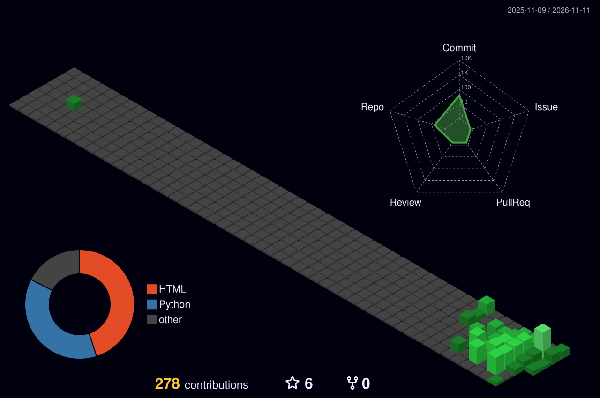

<p align="center">
  <a href="https://github.com/pauloDiego-sudo">
    
  </a>
</p>

<p align="center">
  
  
  
</p>

---

## 🚀 About Me

```python
class Paulo:
    def __init__(self):
        self.role       = "Computer Engineering Student @ IFCE 🇧🇷"
        self.exchange   = "ENSICAEN 🇫🇷 — Cybersecurity & AI (2025–2026)"
        self.experience = "~3 years building software"
        self.stack      = ["Embedded (C/FreeRTOS, C++/Qt)", "Full-Stack", "AI & LLMs"]
        self.languages  = ["Português 🇧🇷", "English 🇬🇧", "Français 🇫🇷", "中文 (basic) 🇨🇳"]
        self.looking_for = "Remote software engineering opportunities 🌍"

    def motto(self):
        return "It works, and it's robust. ✅"
```

- 🔭 Recently finished a **software development internship at Orange Innovation** (France)
- 🌱 Diving deeper into **AI security, LLMs and RAG**
- 🏆 Competed twice in the **ICPC** South America/Brazil regional
- 💬 Ask me about **competitive programming, algorithms, or Brazil!**

---

## 🛠️ Tech Stack

<p align="center">
  <a href="https://skillicons.dev">
    
  </a>
</p>

<details>
<summary><b>🧰 More technologies I've worked with</b></summary>
<br>

| Category | Skills |
| :--- | :--- |
| 🤖 **AI & ML** | PyTorch, TensorFlow, Keras, OpenCV, MediaPipe, YOLOv8, LangChain, RAG |
| 🔐 **Cybersecurity** | Nmap, OpenVAS, Wireshark, OpenSSL, TLS/SSL, Cryptography |
| 🔌 **Embedded** | ESP32 (ESP-IDF), STM32, FreeRTOS, TouchGFX |
| 🖥️ **Desktop & Mobile** | Qt (QML, QTests, Qt Creator), JavaFX, Flutter, Vue.js |
| 💬 **Chatbots & Automation** | Botpress, n8n, Chatwoot |
| 🧪 **Methods** | SCRUM, Clean Code, Design Patterns, TDD/BDD, WCAG 2.2 |

</details>

---

## 📊 GitHub Stats

<p align="center">
  
</p>

<p align="center">
  
</p>

---

## 🎧 When I'm not coding...

<p align="center">
  
</p>

<p align="center">
  
  
  
  
  
  
</p>

---

## 🤝 Let's Connect!

<p align="center">
  <a href="https://www.linkedin.com/in/paulodmeneses"></a>
  <a href="mailto:paulo.meneses3636@gmail.com"></a>
  <a href="https://msng.link/o/?https%3A%2F%2Fu.wechat.com%2FkKNOOP-4aI5rZenjrRGFfqo=wc"></a>
</p>
